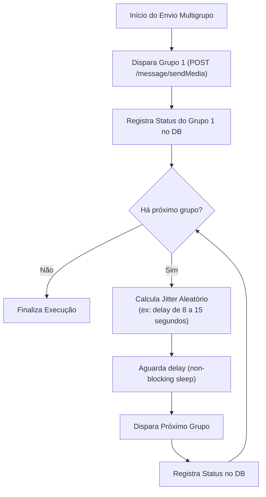

# Arquitetura de Filas, Idempotência e Resiliência (QUEUE_AND_RELIABILITY)

> **Projeto:** SaaS Multi-tenant Shopee + WhatsApp Automation  
> **Tecnologia:** Redis 7 + BullMQ 5 (TypeScript)  
> **Versão:** 1.0 (MVP)  
> **Metodologia:** Spec-Driven Development (SDD)  

---

## 1. Visão Geral e Semântica Realista de Entrega

No envio de mensagens para redes externas (como o WhatsApp via Evolution API), **não existe garantia técnica de entrega exatamente uma vez (*exactly-once delivery*)**, pois timeouts de rede ou falhas no handshake do WhatsApp podem deixar o estado indeterminado.

### Semântica Adotada
O SaaS adota **Pelo Menos Uma Execução (*At-Least-Once Execution*) com Deduplicação Rigorosa de Estado no Início do Pipeline e Prevenção de Retry Cego de Envio**.

- Se o job falhar antes de tentar enviar mensagens ao WhatsApp (ex: falha temporária ao consultar a Shopee), o job é reenfileirado com backoff exponencial.
- Se o envio de uma mensagem ao WhatsApp via Evolution API iniciar e o retorno for indeterminado (ex: timeout HTTP após 30s), **o sistema NÃO faz retry cego automático** para evitar disparos duplicados nos grupos. O registro da publicação é marcado como `FAILED` com nota de timeout para auditoria humana.

---

## 2. Tipos de Filas e Jobs no BullMQ

O sistema opera com 3 filas distintas para separar fluxos críticos:

```
┌─────────────────────────────────────────────────────────────┐
│                    Filas do BullMQ (Redis)                  │
├──────────────────────────────┬──────────────────────────────┤
│ 1. automations-execution-queue│ Processamento das automações │
│ 2. whatsapp-publishing-queue  │ Disparos individuais c/ jitter│
│ 3. system-maintenance-queue   │ Purga de snapshots e checks  │
└──────────────────────────────┴──────────────────────────────┘
```

### Fila 1: `automations-execution-queue`
- **Produtor:** Scheduler Cron (execuções agendadas) ou Controller da API ("Executar Agora").
- **Job Name:** `execute-automation`
- **Job Payload:**
  ```json
  {
    "executionId": "123e4567-e89b-12d3-a456-426614174000",
    "automationId": "987fcdeb-51a2-43f1-b987-123456789abc",
    "tenantId": "f47ac10b-58cc-4372-a567-0e02b2c3d479",
    "triggerSource": "SCHEDULED" // ou "MANUAL"
  }
  ```
- **Concorrência:** Até 5 workers paralelos por container.

---

## 3. Chaves de Idempotência e Bloqueio de Concorrência (Distributed Lock)

Para impedir que a mesma automação execute duas vezes ao mesmo tempo (seja por clique duplo na interface ou sobreposição de agendamento):

### 3.1 Lock Distribuído via Redis (Redlock Pattern Simplificado)
- **Chave de Lock:** `lock:automation:{automationId}`
- **TTL (Time-To-Live):** 600 segundos (10 minutos).
- **Operação Atômica:** `SET lock:automation:{id} {executionId} NX EX 600`
- **Regra de Negócio:** Se o comando retornar `null` (lock já existente), o worker descarta o job imediatamente, registrando no log que a execução foi suprimida por sobreposição de concorrência.

---

## 4. Estratégia de Retries, Backoff e Dead-Letter Queue (DLQ)

### 4.1 Configuração de Retry no BullMQ
```typescript
export const automationJobOptions: JobsOptions = {
  attempts: 3,
  backoff: {
    type: 'exponential',
    delay: 15000, // 15s inicial -> 30s -> 60s
  },
  removeOnComplete: {
    age: 24 * 3600, // mantém por 24h para telemetria
    count: 1000,
  },
  removeOnFail: false, // jobs com falha vão para inspeção (DLQ)
};
```

### 4.2 Falhas Fatais vs Falhas Recuperáveis
- **Falha Recuperável (Gera Retry):**
  - Timeout momentâneo ao conectar à Shopee API (`503 Service Unavailable`, `ETIMEDOUT`).
  - Rate limiting da Shopee (`429 Too Many Requests`).
- **Falha Fatal (Não Gera Retry - Aborta Imediatamente):**
  - Instância do WhatsApp desconectada (`close`).
  - Credencial Shopee inválida (`Invalid Signature` ou `AppId not found`).
  - Nenhum produto elegível após filtro de 7 dias (`SKIPPED_NO_ELIGIBLE_PRODUCT`).

---

## 5. Orquestração da Publicação Multigrupo com Jitter

Para proteger o chip/número do WhatsApp contra banimento por comportamento de disparador massivo:



### Regras Mandatórias:
1. **Transacionalidade Isolada por Destino:** O loop de envio nunca falha a execução completa caso um grupo retorne erro (ex: bot foi removido do grupo). O grupo falho recebe status `FAILED` e o loop avança para o próximo grupo.
2. **Jitter Configurável:** O intervalo entre mensagens para destinos diferentes é parametrizável na automação (`jitterSeconds`, padrão 10 segundos), com variação pseudo-aleatória ($\pm 20\%$) para evitar periodicidade exata detectável.
