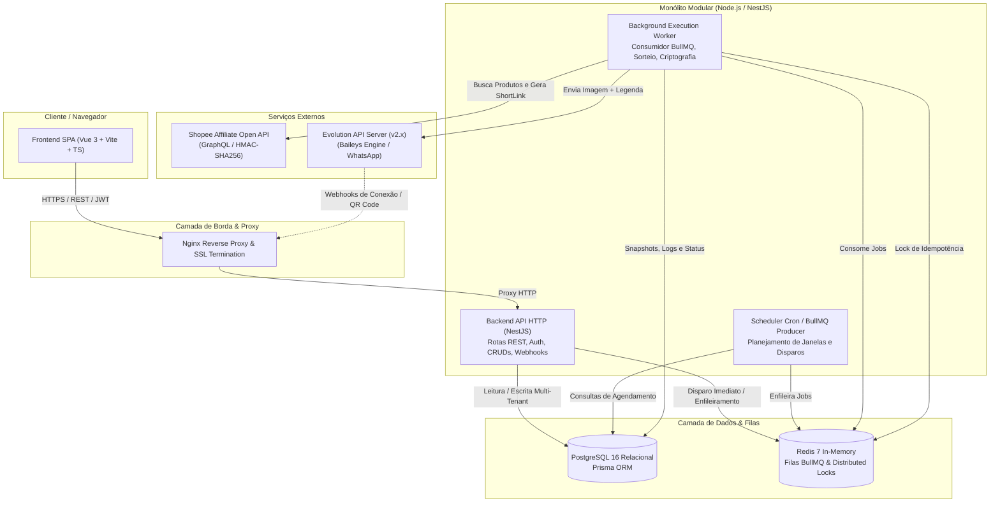
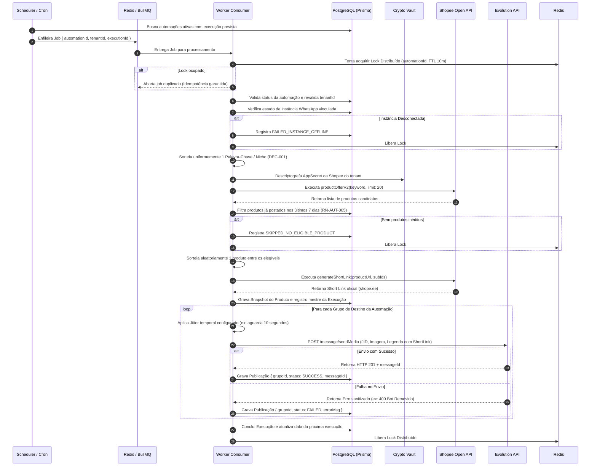

# Arquitetura do Sistema e Design de Componentes (SYSTEM_ARCHITECTURE)

> **Projeto:** SaaS Multi-tenant Shopee + WhatsApp Automation  
> **Versão:** 1.0 (MVP)  
> **Metodologia:** Spec-Driven Development (SDD)  
> **Status:** Arquitetura Proposta para Homologação  
> **Autores:** Software Architect & Security Architect Team  

---

## 1. Visão Geral Arquitetural

O sistema foi desenhado como um **Monólito Modular Pragmático**, priorizando alta coesão, baixo acoplamento e simplicidade operacional no MVP, sem fragmentação prematura em microsserviços. 

### 1.1 Premissas Estruturais
1. **Compartilhamento de Domínio:** A camada web (API HTTP) e os workers de background (processadores de filas BullMQ) executam na mesma base de código TypeScript, compartilhando entidades de domínio, schemas de validação Zod/Prisma e lógica de negócio.
2. **Isolamento de Execução:** Embora compartilhem o código, os containers de API (NestJS HTTP) e Workers (BullMQ Consumers) rodam em processos separados no Docker Compose, permitindo escala horizontal independente.
3. **Multi-Tenancy por Coluna com Validação em Camadas:** Isolamento lógico estrito por `tenant_id` aplicado via middleware/guards na API e revalidado obrigatoriamente dentro de cada worker de background.

---

## 2. Diagrama de Componentes de Alto Nível (C4 Container Level)

---

## 3. Módulos Internos do Backend (Monólito Modular)

A estrutura do NestJS é organizada em módulos funcionais estritos:

| Módulo | Responsabilidade Principal |
| :--- | :--- |
| **`auth`** | Cadastro, login, hash de senhas (Argon2id), emissão/validação de JWT e recuperação de credenciais. |
| **`tenants`** | Provisionamento e isolamento de tenants, configurações de fuso horário e políticas da organização. |
| **`crypto-vault`** | Criptografia simétrica autenticada (AES-256-GCM), decifragem em memória e mascaramento de segredos. |
| **`shopee-integration`** | Cliente GraphQL da Shopee, cálculo da assinatura SHA-256, `productOfferV2` e `generateShortLink`. |
| **`evolution-integration`**| Cliente REST da Evolution API v2, criação de instâncias, QR Code, listagem de grupos e `sendMedia`. |
| **`instances`** | Gerenciamento de ciclo de vida das instâncias WhatsApp vinculadas ao tenant. |
| **`groups`** | Sincronização, filtragem e persistência de grupos de WhatsApp (JIDs oficiais). |
| **`automations`** | Regras de automação, associação com palavras-chave de nicho, grupos de destino e janelas horárias. |
| **`scheduler`** | Verificação periódica de cronograma de execuções com base no timezone do tenant e limites diários. |
| **`queue-engine`** | Produtores e consumidores BullMQ, controle de concorrência com locks e retries inteligentes. |
| **`publications`** | Orquestração do envio com jitter temporal, controle de transação e status por destino. |
| **`history`** | Auditoria e consultas de telemetria, erros sanitizados e snapshots de produtos postados. |
| **`dashboard`** | Agregação analítica em tempo real para alimentação de cards e métricas da interface. |

---

## 4. Diagrama de Sequência do Fluxo de Execução e Publicação

O diagrama abaixo detalha a interação completa desde o disparo do agendador até a entrega no WhatsApp:

---

## 5. Diretrizes de Comunicação e Resiliência

1. **Compartilhamento de Código via Monorepo Modular:**  
   A lógica de domínio (cálculo de jitter, validação de janela horária, montagem do payload da Shopee) fica centralizada em `src/modules/` e é consumida tanto pelos controllers HTTP quanto pelos processors do BullMQ.
2. **Defesa em Profundidade no Multi-Tenancy:**  
   O `tenantId` é injetado no job da fila pelo agendador. Ao iniciar o processamento, o worker valida se a automação, a instância, as credenciais e os grupos de fato pertencem a esse mesmo `tenantId` antes de iniciar qualquer chamada externa.
3. **Isolamento de Falhas:**  
   Instabilidades na Shopee ou na Evolution API não quebram o processo principal da aplicação nem afetam outras automações em execução concorrente.
