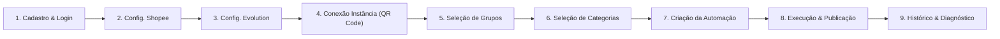

# Personas e Jornadas do Usuário (PERSONAS_AND_JOURNEYS)

> **Projeto:** SaaS Multi-tenant Shopee + WhatsApp Automation  
> **Versão do Documento:** 1.0 (MVP)  
> **Metodologia:** Spec-Driven Development (SDD)  

---

## 1. Mapeamento de Personas

### Persona 1: Lucas Martins — O Afiliado Independente de "Achadinhos"
- **Perfil:** Empreendedor digital individual de 28 anos, atua há 2 anos divulgando ofertas de e-commerce.
- **Estrutura:** Opera 8 grupos de WhatsApp divididos por nichos (Achadinhos para Casa, Moda Feminina, Eletrônicos Baratos).
- **Dores Principais:**
  - Perde de 3 a 4 horas por dia caçando promoções no app da Shopee e gerando links no portal de afiliados.
  - Frequentemente posta produtos que já postou há dois dias porque esquece o que enviou.
  - Já teve chip bloqueado no WhatsApp por postar muito rápido manualmente em vários grupos.
- **Objetivo no SaaS:** Cadastrar suas automações uma única vez e deixar o sistema publicando ofertas com seu link oficial ao longo do dia com segurança.

---

### Persona 2: Mariana Souza — Gestora de Tráfego e Agência de Afiliados
- **Perfil:** Proprietária de microagência com 32 anos, gerencia mais de 30 grupos de WhatsApp para parceiros afiliados.
- **Estrutura:** Opera servidores próprios da Evolution API e precisa manter múltiplos conjuntos de credenciais e instâncias isoladas.
- **Dores Principais:**
  - Erro humano ao misturar links de afiliados de contas diferentes, gerando perda financeira de comissões.
  - Falta de visibilidade consolidada de quais instâncias estão conectadas ou caídas.
- **Objetivo no SaaS:** Ter certeza matemática de isolamento de credenciais e receber alertas caso alguma instância caia.

---

## 2. Jornada Completa do Cliente no SaaS

A jornada é dividida em 9 etapas sequenciais:

---

### Etapa 1: Cadastro e Autenticação
- **Fluxo Principal (Caminho Feliz):**
  1. O usuário acessa a landing/login e clica em "Criar Conta".
  2. Informa Nome, Email corporativo/pessoal e cria uma senha forte (mínimo 8 caracteres, maiúscula, número e símbolo).
  3. O backend cria o usuário e provisiona automaticamente um novo `Tenant` exclusivo.
  4. O usuário é redirecionado para a tela de Login ou já entra na sessão com token JWT seguro.
- **Fluxos de Exceção:**
  - *Email já cadastrado:* Sistema exibe mensagem clara sem expor enumeração de usuários ("Email já registrado no sistema").
  - *Senha fraca:* Validação em tempo real no formulário bloqueia submissão.
  - *Esquecimento de senha:* Fluxo de recuperação via link temporário assinado criptograficamente.

---

### Etapa 2: Configuração da Credencial Shopee
- **Fluxo Principal (Caminho Feliz):**
  1. O usuário navega até "Configurações > Credenciais Shopee".
  2. Insere o `AppId` e o `AppSecret` obtidos no portal oficial da Shopee Affiliate Open API.
  3. Clica em "Validar e Salvar".
  4. O backend realiza um handshake de teste com a API da Shopee (gerando a assinatura HMAC oficial).
  5. Sendo bem-sucedido, o backend criptografa o `AppSecret` (AES-256-GCM), salva no banco e retorna status "Conectado e Válido".
  6. A interface passa a exibir o segredo mascarado (`shopee_app_secret: ************abcd`).
- **Fluxos de Exceção:**
  - *Credenciais Inválidas:* A Shopee retorna código de erro de autenticação (ex: assinatura inválida ou credencial não encontrada). O backend retorna erro amigável e **não** salva a credencial em estado válido.
  - *Falha de Conectividade:* Timeout ao conectar à API Shopee. O sistema sugere tentar novamente em instantes.

---

### Etapa 3: Configuração do Servidor Evolution API
- **Fluxo Principal (Caminho Feliz):**
  1. O usuário navega até "Configurações > Servidor WhatsApp".
  2. Informa a `URL Base` do servidor Evolution (ex: `https://evolution.dominio.com`) e a `API Key` de acesso.
  3. Clica em "Testar e Salvar".
  4. O backend faz uma requisição de healthcheck/ping no endpoint oficial da Evolution API.
  5. Validada a conexão, a API Key é salva de forma criptografada em repouso.
- **Fluxos de Exceção:**
  - *URL Inacessível ou API Key Inválida:* O sistema aponta a falha e orienta checar se o servidor Evolution está ativo e se a chave global está correta.

---

### Etapa 4: Criação e Conexão da Instância WhatsApp (QR Code)
- **Fluxo Principal (Caminho Feliz):**
  1. O usuário clica em "Instâncias WhatsApp > Nova Instância".
  2. Informa um nome amigável para identificar a instância (ex: "WhatsApp Ofertas Casa").
  3. O backend invoca a Evolution API para criar a instância com o provider Baileys.
  4. O backend solicita o QR Code de conexão e renderiza na tela do usuário.
  5. O usuário abre o aplicativo WhatsApp no celular, vai em "Aparelhos Conectados" e lê o QR Code.
  6. O webhook/polling detecta a mudança de estado para `open`/`CONNECTED`.
  7. A tela atualiza automaticamente exibindo o status verde "Conectado".
- **Fluxos de Exceção:**
  - *Expiração do QR Code:* Caso o usuário não escaneie em até 60 segundos, a interface exibe botão "Gerar Novo QR Code".
  - *Desconexão do Celular:* Se o usuário desconectar pelo WhatsApp no celular, a instância é atualizada para `DISCONNECTED` e notificações visuais são exibidas.

---

### Etapa 5: Consulta e Seleção de Grupos
- **Fluxo Principal (Caminho Feliz):**
  1. Com a instância conectada, o usuário clica em "Sincronizar Grupos".
  2. O backend consulta a Evolution API pelos grupos dos quais a conta participa.
  3. Os grupos são salvos no banco sob o tenant do usuário, preservando o JID original (`120363xxx@g.us`) e o nome (`subject`).
  4. O usuário visualiza a lista com campo de busca e filtros.
- **Fluxos de Exceção:**
  - *Instância desconectada:* Bloqueio de consulta com aviso para reconectar o aparelho.
  - *Nenhum grupo encontrado:* Orientação para criar ou ingressar em grupos no WhatsApp da instância.

---

### Etapa 6: Consulta e Seleção de Categorias
- **Fluxo Principal (Caminho Feliz):**
  1. O usuário navega até a listagem de categorias disponíveis.
  2. O sistema apresenta as categorias comprovadamente suportadas pela API de ofertas da Shopee.
  3. Se a operação oficial não expuser categorias nativas, o sistema exibe os nichos/filtros validados formalmente na documentação oficial (conforme definido no Prompt 02).
- **Fluxos de Exceção:**
  - *API da Shopee indisponível:* Exibição de aviso e instrução para aguardar restabelecimento da Shopee.

---

### Etapa 7: Criação de Automações
- **Fluxo Principal (Caminho Feliz):**
  1. O usuário clica em "Automações > Nova Automação".
  2. Define o Nome da automação (ex: "Achadinhos Diários - Grupo VIP").
  3. Seleciona a Instância WhatsApp conectada.
  4. Seleciona um ou mais Grupos de destino.
  5. Seleciona uma ou mais Categorias de produtos.
  6. Configura o Agendamento:
     - Frequência (ex: a cada 60 minutos).
     - Janela de publicação (ex: das 08:00 às 22:00).
     - Dias da semana (ex: Segunda a Sábado).
     - Janela de desduplicação (padrão: 7 dias sem repetir produto).
     - Jitter de segurança entre grupos (ex: 10 segundos).
  7. Clica em "Salvar e Ativar".
- **Fluxos de Exceção:**
  - *Nenhum grupo selecionado:* Validação de formulário impede submissão.
  - *Credencial Shopee ausente ou inválida:* Sistema bloqueia ativação e redireciona para configuração de credenciais.

---

### Etapa 8: Execução e Publicação Automática
- **Fluxo Principal (Caminho Feliz):**
  1. O worker de agendamento identifica que a automação está ativa e dentro da janela permitida.
  2. Realiza lock de concorrência para garantir que apenas um worker processe aquela automação por vez.
  3. Seleciona aleatoriamente uma das categorias configuradas.
  4. Consulta a API da Shopee por produtos elegíveis na categoria.
  5. Filtra produtos já publicados pela mesma automação nos últimos 7 dias.
  6. Sorteia aleatoriamente um produto entre os elegíveis (evitando viés de sempre pegar o item #1).
  7. Chama a operação oficial da Shopee para gerar o Short Link de afiliado com a credencial proprietária do tenant.
  8. Para cada grupo de destino:
     - Aplica o jitter configurado.
     - Dispara a imagem com legenda (Título, Preço e Link) via Evolution API.
     - Registra o resultado individual daquele grupo (`SUCESSO`).
  9. Registra a execução geral como concluída com sucesso.
- **Fluxos de Exceção:**
  - *Nenhum produto elegível encontrado (esgotamento de desduplicação):* Registra na execução status `SKIPPED_NO_PRODUCT` sem quebrar o agendador e sem forçar repetição.
  - *Falha na geração do link de afiliado:* Interrompe imediatamente o disparo e marca a execução com erro (não posta link sem comissão).
  - *Falha no envio para um grupo específico:* Registra falha para o grupo com erro sanitizado e segue para o próximo grupo sem interromper a fila.

---

### Etapa 9: Histórico e Diagnóstico
- **Fluxo Principal (Caminho Feliz):**
  1. O usuário acessa "Histórico de Execuções".
  2. Visualiza a lista de todas as publicações com badges visuais (`Sucesso`, `Falha Parcial`, `Erro`).
  3. Clica em uma execução para ver os detalhes:
     - Imagem, título e preço do produto selecionado.
     - Link de afiliado gerado.
     - Detalhamento de cada grupo com timestamp exato e tempo de resposta.
- **Fluxos de Exceção:**
  - *Falhas registradas:* O usuário visualiza o motivo claro da falha (ex: "Instância offline no momento do envio" ou "Número do WhatsApp foi removido do grupo").
